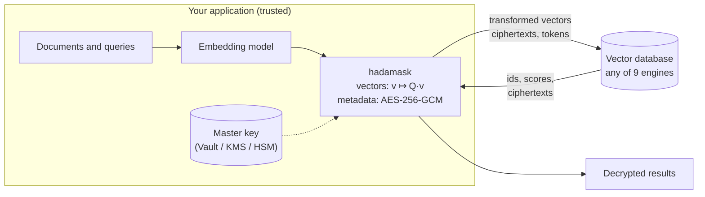

<div align="center">

# hadamask

**Client-side protection for vector databases.**
Keyed orthogonal obfuscation for embeddings, AES-256-GCM for metadata. Similarity search stays exact.

[](https://github.com/cernica/hadamask/actions/workflows/ci.yml)
[](https://pypi.org/project/hadamask/)
[](https://github.com/cernica/hadamask/blob/main/LICENSE)
[](https://github.com/cernica/hadamask/blob/main/pyproject.toml)
[](https://doi.org/10.3390/app162010259)


[Quick start](#quick-start) · [Security model](#security-model) · [Store API](#the-store-api) · [Databases](#supported-databases) · [Key management](#key-management) · [Frameworks](#langchain-and-llamaindex) · [Design](#design)

</div>

---

Vector databases need the geometry of your embeddings to search them, so the vectors usually
sit in the database exactly as your embedding model produced them, next to the documents'
metadata. Anyone who gets a snapshot, a backup or an over-privileged database account gets
both.

**hadamask** protects that data before it leaves your application:

- **Embeddings** go through a secret orthogonal transform. Queries get the same transform,
  so the database computes exactly the same cosine, dot-product and L2 scores as on the
  clear vectors. Your index, your database and your recall stay the same.
- **Metadata and document text** are encrypted field by field with AES-256-GCM, with a fresh
  nonce per value and length padding. An amount of `100.00` and one of `9,999,999.99` produce
  ciphertexts of the same length.
- **Filters still work.** Fields you declare `blind` get keyed equality tokens. Fields you
  declare `plaintext` stay in clear and support ranges.
- **Keys stay with you.** It is a library, not a proxy or a service. The master key can stay
  wrapped by HashiCorp Vault, AWS KMS, Google Cloud KMS or Azure Key Vault.

It works with **Qdrant, Weaviate, Milvus, Chroma, pgvector, Elasticsearch, OpenSearch, Redis
and MongoDB Atlas**, behind one API, and with **LangChain** and **LlamaIndex**.

The method and its leakage are analysed in
[*What a Secret Rotation Buys: Exact Retrieval and Measured Leakage in Vector Databases*](https://doi.org/10.3390/app162010259)
(Cernica & Popescu, *Applied Sciences* 2026).

> [!IMPORTANT]
> **What it is not.** The embedding transform is **obfuscation with measured leakage, not
> encryption**. It hides the coordinate system, but the relative geometry of your corpus
> (which documents are similar to which) stays visible. In the paper's experiments, an
> attacker holding only the protected vectors and public data from the same distribution
> inferred document topics with **81–87% accuracy** (four classes). Metadata *is*
> encrypted. Read the [security model](#security-model) before deploying. hadamask is alpha
> software and has not had an external cryptographic audit.

> [!NOTE]
> **What "exact" means.** Scores are mathematically identical to those on the clear vectors
> (up to float32 rounding). With an approximate index such as HNSW, the database returns
> what that index would return on the clear data: recall against exhaustive search is the
> engine's own, not hadamask's. In the [benchmark](#benchmarks), recall and the top-10 sets
> match the unprotected collections.

## Contents

- [How it works](#how-it-works)
- [Security model](#security-model)
- [Install](#install)
- [Quick start](#quick-start)
- [Core concepts](#core-concepts) · [Choosing a transform: hadamard or dense](#choosing-a-transform)
- [The store API](#the-store-api)
- [Supported databases](#supported-databases)
- [SDK wrappers for Qdrant and Weaviate](#sdk-wrappers-for-qdrant-and-weaviate)
- [LangChain and LlamaIndex](#langchain-and-llamaindex)
- [Key management](#key-management)
- [Key rotation](#key-rotation)
- [Command line](#command-line)
- [Design](#design)
- [Benchmarks](#benchmarks)
- [Testing](#testing)
- [Roadmap](#roadmap)
- [Citation](#citation)

## How it works



1. Your application embeds a document as usual.
2. hadamask pads the vector to a power-of-two dimension and applies the keyed orthogonal map
   `Q = H·D2·P·H·D1`, built from Walsh–Hadamard transforms, secret sign flips and a secret
   permutation. Because `Q` is orthogonal, `⟨Qu, Qv⟩ = ⟨u, v⟩`.
3. Each metadata field is serialized, padded, and encrypted with AES-256-GCM, or tokenized
   or left in clear, depending on your policy.
4. The database indexes and searches what it receives, with no plugin and no configuration
   change. Queries get the same transform, so rankings and scores are those of the clear data.
5. Results are decrypted in your process.

## Security model

The threat is an attacker who obtains a **copy of the database** (a snapshot, a backup, a
leaked dump or an over-privileged account) but not your application or your key.

| What is stored | Protection | What an attacker with a snapshot still learns |
|---|---|---|
| Encrypted fields (default for every field) | AES-256-GCM, fresh 96-bit nonce per value, field name and key id bound as associated data | That the field exists. Short values reveal nothing about their length; long values reveal a power-of-two size class, or nothing with `fixed_lengths` |
| Blind fields | Encrypted as above, plus an HMAC-SHA256 equality token | Which records share a value, and how often each value occurs |
| Plaintext fields | None. This is your explicit choice | Everything |
| Embeddings | Keyed orthogonal transform | **All pairwise similarities** (the Gram matrix): clusters, duplicates, nearest-neighbour graph, spectrum. Not the coordinates themselves |

What the paper measures about the embedding leakage:

- Search is exact: exhaustive top-10 sets are identical to clear search across three BEIR
  datasets and three encoders. Five of six database engines return identical sets; the
  sixth (Chroma) differs only within its own re-indexing variability.
- If an attacker knows enough plaintext–vector pairs (as many as the dimension), the map is
  recovered exactly.
- Without any pairs, public embeddings from the same distribution still support topic
  inference: median four-way topic accuracy of 0.81–0.87 in the paper's experiments.

**Not covered:** compromise of the application host or the key; attackers who can insert
chosen documents and later read a snapshot; query and access-pattern leakage; server-side
vectorizers (the database must never receive clear text or clear vectors).

Use hadamask where the threat is data at rest in a database you do not fully control. It
raises the bar from "read the dump" to "mount an inference attack, with auxiliary data,
against a geometry-only view". If you need the corpus geometry itself hidden, you need a
cryptographic protocol or trusted hardware. See [SECURITY.md](https://github.com/cernica/hadamask/blob/main/SECURITY.md).

## Install

```bash
pip install "hadamask[qdrant]"
```

Pick the extras you need: `qdrant`, `weaviate`, `milvus`, `chroma`, `pgvector`,
`elasticsearch`, `opensearch`, `redis`, `mongodb`, `langchain`, `llamaindex`, and for key
management `vault`, `aws`, `gcp`, `azure` (or `kms` for all four). `all` installs everything.
Python 3.10 or newer.

## Quick start

This runs as is, with an in-memory Qdrant ([`examples/quickstart.py`](https://github.com/cernica/hadamask/blob/main/examples/quickstart.py)):

```python
import numpy as np
from qdrant_client import QdrantClient, models

from hadamask import MasterKey, MetadataPolicy, Protector
from hadamask.adapters.qdrant import QdrantStore

# One key per tenant. "client" can be filtered on, "year" stays in clear,
# every other field ("text", "amount", ...) is encrypted.
protector = Protector(MasterKey.generate("demo1"), MetadataPolicy(plaintext=["year"], blind=["client"]))

client = QdrantClient(":memory:")
store = QdrantStore(client, protector, payload_schema={"year": models.PayloadSchemaType.INTEGER})
store.create_collection("docs", dim=384, metric="cosine")        # stored as 512-d

embeddings = np.random.default_rng(0).standard_normal((3, 384))  # use your embedding model
store.upsert(
    "docs",
    ids=[1, 2, 3],
    vectors=embeddings,
    payloads=[
        {"text": "Wire transfer of 1,250,000 EUR to RO49AAAA1B31007593840000", "client": "ACME", "year": 2026},
        {"text": "Loan agreement: principal 480,000 EUR at 4.1% fixed", "client": "ACME", "year": 2025},
        {"text": "Quarterly audit report for the treasury department", "client": "Globex", "year": 2026},
    ],
)

for hit in store.search("docs", embeddings[0], k=2, where={"client": "ACME"}):
    print(hit.id, round(hit.score, 3), hit.payload["text"])
```

What Qdrant stores looks like this (abridged):

```text
payload: {'text': 'hm1:demo1:0Zh9ab4mBNDEKBEwmzkCVnWsvFpnz2...', 'client': 'hm1:demo1:LXXVS92j-4jE...',
          '_hmb_client': 'v5z-4r66z7jduraiUjjnKg', 'year': 2026}
vector:  [-0.007, 0.037, 0.047, 0.082, -0.035, 0.01, ...]   (512 dims)
```

In production, load the key from a key manager instead of generating it
([Key management](#key-management)).

## Core concepts

### `MasterKey`

A 256-bit secret plus a public `key_id` that is stored next to every ciphertext. Every other
secret is derived from it with domain-separated HMAC-SHA256: the transform's signs and
permutation, the AES key, and the blind-token key.

```python
MasterKey.generate("prod-2026")                  # new random key
MasterKey.from_env()                             # HADAMASK_MASTER_KEY (base64), HADAMASK_KEY_ID
Keyring.from_wrapped(wrapper, wrapped_string)    # unwrapped by Vault / KMS (see below)
```

Use one key per tenant: different keys give unrelated coordinate systems.

### `MetadataPolicy`

Every payload field falls into one of three classes:

| Class | Declared as | Stored as | Filters |
|---|---|---|---|
| encrypted | default | `hm1:<key_id>:<base64url(nonce‖ciphertext‖tag)>` | none |
| blind | `blind=[...]` | ciphertext, plus `_hmb_<field>` token(s) | `$eq $ne $in $nin` |
| plaintext | `plaintext=[...]` | the value itself | all operators, including ranges |

```python
MetadataPolicy(
    plaintext=["year", "department"],
    blind=["client_id", "tags"],         # list values get one token per element
    min_padded_length=64,                # every short value pads to 64 bytes
    fixed_lengths={"text": 8192},        # this field always pads to exactly 8 KiB
)
```

Keep `blind` and `plaintext` as small as possible. A blind field with few possible values
(status, country) is open to frequency analysis.

### `Protector`

Holds a key and a policy and does all the cryptography. Adapters never see keys.

```python
protector = Protector(key, policy, previous_keys=[old_key])

protector.encode(vectors)           # (n, d) -> (n, D) float32; documents and queries alike
protector.decode(vectors, dim=384)  # back to native vectors
protector.encrypt_payload(payload)  # -> stored dict
protector.decrypt_payload(stored)   # -> clear dict (also reads previous keys)
protector.stored_dim(384)           # 512: create collections with this size
```

### Choosing a transform

| | `transform="hadamard"` (default) | `transform="dense"` |
|---|---|---|
| Map | `H·D2·P·H·D1` (paper, Eq. 3), structured, `O(d log d)` | Dense Haar-uniform orthogonal matrix, `O(d²)` |
| Stored dimension | Next power of two: 384 → 512, 1536 → **2048** | **Native**: 1536 stays 1536 |
| Storage overhead (1536-d, measured) | +34% | +2–5% |
| pgvector HNSW with 1536-d embeddings | **Not possible** (pgvector limit: 2000 dims) | Works |
| Client memory | Negligible | `8·d²` bytes per dimension: 19 MB for 1536, 75 MB for 3072 |
| Security analysis | Structured key family; the paper's Haar theorems do not apply directly | Exactly the Haar ideal of the paper's Section 3.4 |

```python
protector = Protector(key, policy, transform="dense")
```

**What the two transforms are.**

- `hadamard` is the construction from the paper. `H` is the Walsh–Hadamard matrix: a
  fixed, public matrix of ±1 entries that can be applied in `O(d log d)`. The secret is the
  sign vectors `D1`, `D2` and the permutation `P`. That speed comes from structure: only
  power-of-two sizes work, and every key selects a map from a small, highly structured family.
- `dense` is a full `d × d` orthogonal matrix with no structure at all. It is drawn
  *uniformly at random among all rotations and reflections* of `d`-dimensional space:
  hadamask fills a matrix with Gaussian numbers derived from your key, orthogonalizes it
  (QR), and fixes the column signs. Mathematicians call that uniform distribution the *Haar
  measure*, which is why the paper calls it the Haar ideal. This has nothing to do with the
  Haar *wavelet*, and no Hadamard matrix is involved. The same key always gives the same
  matrix.

**Which one to use.**

| Your situation | Use |
|---|---|
| Embedding dimension is a power of two (256, 512, 1024, 4096) | `hadamard`: no padding needed, smallest memory footprint |
| 384, 768, 1536, 3072 or any other dimension | `dense`: avoids padding (+33% storage for 1536 → 2048) |
| pgvector with HNSW and more than 1024 dimensions | `dense` (with `hadamard`, 1536-d vectors become 2048-d, above pgvector's 2000-dimension HNSW limit) |
| You want the paper's formal results for the ideal transform to apply to your data | `dense` |
| Very large dimensions (8192+) or memory-constrained clients | `hadamard` (`dense` keeps a `d × d` matrix: 537 MB at 8192) |
| You want exactly the construction evaluated experimentally in the paper | `hadamard` |

Pick once per collection: vectors written with one transform cannot be searched with the
other. To switch, `copy_to` a new collection whose store uses a `Protector` with the other
transform.

`dense` does not make the attacks measured in the paper harder: the geometry leaks the
same way, and `d` known pairs recover either map. What it changes is that the paper's
results for the ideal transform (a snapshot reveals exactly the Gram matrix and nothing
more) describe your stored data directly, with no structured family left that a future
attack could exploit. It also removes padding.

Both preserve scores exactly, and both leak the same relative geometry (the Gram matrix).
Padding to a larger dimension adds **no** security: the data still spans a `d`-dimensional
subspace, so its rank reveals `d`, and its spectrum is unchanged (paper, Proposition 1). For
1536-d or 3072-d embeddings, or any pgvector deployment, use `dense`. A collection must be
written and queried with the same transform.

## The store API

Every adapter implements the same interface (`hadamask.adapters.base.ProtectedStore`).

```python
store.create_collection("docs", dim=1536, metric="cosine")   # "cosine" | "dot" | "l2"
store.register_collection("docs", dim=1536, metric="cosine") # for collections created elsewhere
store.drop_collection("docs")
```

### Writing

```python
store.upsert("docs", ids, vectors, payloads, batch_size=500)   # any size, split into batches
store.update_payload("docs", id, {"status": "closed"})          # merge and re-encrypt, vector kept
store.update_payload("docs", id, new_payload, merge=False)      # replace
store.delete("docs", [id1, id2])
store.delete("docs", where={"year": {"$lt": 2020}})
```

`upsert` replaces records with the same id. The lengths of `ids`, `vectors` and `payloads`
must match, otherwise it raises instead of silently dropping records.

### Searching

```python
hits = store.search(
    "docs", query_vector, k=10,
    where={"client_id": {"$in": ["C-17", "C-18"]}, "year": {"$gte": 2024}},
    offset=10,                   # paging
    score_threshold=0.75,        # minimum similarity (maximum distance for l2)
    fields=["text", "client_id"],# decrypt only these fields
    with_vectors=True,           # native vectors on each hit
    hnsw_ef=256,                 # engine-specific options, see below
)
hit.id, hit.score, hit.payload, hit.vector

store.search_many("docs", query_vectors, k=5)     # one result list per query
```

`hit.score` means the same thing on every database, and equals the value computed on the
clear vectors:

| Metric | `score` |
|---|---|
| `cosine` | cosine similarity (higher is closer) |
| `dot` | inner product (higher is closer) |
| `l2` | Euclidean distance, not squared (lower is closer) |

### Reading

```python
store.get("docs", ids, with_vectors=True, fields=["year"])
store.count("docs", where={"client_id": "C-17"})
for record in store.scroll("docs", where={"year": 2026}, batch_size=500, with_vectors=True):
    ...
```

### Filters

MongoDB-style. Several fields in one dict are combined with AND.

| Operator | Example | Plaintext | Blind |
|---|---|:-:|:-:|
| equality | `{"client_id": "C-17"}` or `{"$eq": ...}` | ✓ | ✓ |
| `$ne` | `{"status": {"$ne": "closed"}}` | ✓ | ✓ |
| `$in`, `$nin` | `{"client_id": {"$in": ["C-17", "C-18"]}}` | ✓ | ✓ |
| `$gt`, `$gte`, `$lt`, `$lte` | `{"year": {"$gte": 2024, "$lt": 2027}}` | ✓ | — |
| `$and`, `$or` | `{"$or": [{"client_id": "C-17"}, {"year": 2026}]}` | ✓ | ✓ |

- Filters on encrypted-only fields, and ranges on blind fields, raise `ValueError` before
  anything is sent: the database cannot evaluate them.
- `$ne` and `$nin` also match records that do not have the field, as in MongoDB.
- On a list-valued blind field, equality means "the list contains this value".

### Migrating and rotating keys

```python
store.copy_to("docs", target_store, "docs_v2", where=None, batch_size=500)
```

Records are decrypted with this store's key and re-protected with the target's. Use it to
move between databases, or to rotate keys ([Key rotation](#key-rotation)).

## Supported databases

| Database | Class | Tested against | Search options |
|---|---|---|---|
| Qdrant | `QdrantStore` | 1.19, Qdrant Cloud | `hnsw_ef`, `exact`, other `SearchParams` |
| Weaviate | `WeaviateStore` | 1.33, Weaviate Cloud 1.40 | — |
| Milvus | `MilvusStore` | 2.6 | `ef`, `nprobe`, `search_list`, `radius`, `range_filter`, `level` |
| Chroma | `ChromaStore` | 1.5 | — |
| pgvector | `PgVectorStore` | PostgreSQL 17, pgvector 0.8 | `ef_search`, `iterative_scan` |
| Elasticsearch | `ElasticsearchStore` | 8.17 | `num_candidates` |
| OpenSearch | `OpenSearchStore` | 2.19 | `num_candidates`, `ef_search` |
| Redis Stack | `RedisStore` | 7.4 | `ef_runtime` |
| MongoDB Atlas Vector Search | `MongoStore` | 8.0 (atlas-local) | `num_candidates`, `exact` |

```python
from hadamask.adapters.qdrant import QdrantStore             # QdrantStore(client, protector, payload_schema=...)
from hadamask.adapters.weaviate import WeaviateStore         # WeaviateStore(client, protector, index_type="hnsw")
from hadamask.adapters.milvus import MilvusStore             # MilvusStore(client, protector, index_type="HNSW")
from hadamask.adapters.chroma import ChromaStore             # ChromaStore(client, protector)
from hadamask.adapters.pgvector import PgVectorStore         # PgVectorStore("postgresql://...", protector, hnsw=True)
from hadamask.adapters.elasticsearch import ElasticsearchStore
from hadamask.adapters.opensearch import OpenSearchStore
from hadamask.adapters.redis import RedisStore               # RedisStore(client, protector, numeric_fields=["year"])
from hadamask.adapters.mongodb import MongoStore             # MongoStore(client["db"], protector, exact=True)
```

Every adapter passes the same contract test against a real server. The test covers recall
against exact search, every filter operator checked against reference semantics, counts,
paging, thresholds, projections, scroll, payload updates, `copy_to` under a second key,
deletion by filter, and a check that **only ciphertext reaches the database**. A second test
checks that `score` equals the clear value for all three metrics on all nine engines. In
these tests, recall@10 is 1.0 on every engine.

Per-database notes, including index choices, quantization, and limits such as Redis ranges
needing `numeric_fields`, are in [docs/databases.md](https://github.com/cernica/hadamask/blob/main/docs/databases.md).

> [!NOTE]
> Never configure a server-side vectorizer (Weaviate `text2vec-*`, Chroma embedding
> functions, and so on): it would receive clear text. The Weaviate adapters refuse such
> collections.

## SDK wrappers for Qdrant and Weaviate

If your code already uses the official SDKs, the wrappers keep the same method names.

```python
from hadamask.adapters.qdrant import ProtectedQdrantClient

qdrant = ProtectedQdrantClient(QdrantClient(url), protector)
qdrant.create_collection("docs", vectors_config=models.VectorParams(size=1536, distance=models.Distance.COSINE))
qdrant.upsert("docs", points=[models.PointStruct(id=1, vector=embedding, payload={"text": "...", "client": "ACME"})])
qdrant.query_points("docs", query=query_embedding, limit=5,
                    query_filter=models.Filter(must=[qdrant.match("client", "ACME")]))
```

```python
from hadamask.adapters.weaviate import ProtectedWeaviateCollection

docs = ProtectedWeaviateCollection(client.collections.get("Docs"), protector, dim=1536)
docs.data.insert({"text": "...", "client": "ACME"}, vector=embedding)
docs.query.near_vector(query_embedding, limit=5, filters=docs.match("client", "ACME"))
```

Methods that would read or write data without protection (`set_payload`, `upload_points`,
`batch`, `query.hybrid`, `prefetch`, ...) raise instead of passing through. `.unprotected`
gives explicit access to the raw client.

## LangChain and LlamaIndex

One wrapper covers every vector store these frameworks support.

```python
from hadamask.integrations.langchain import ProtectedVectorStore
from langchain_qdrant import QdrantVectorStore

store = ProtectedVectorStore(
    build_inner=lambda emb: QdrantVectorStore(client, "docs", embedding=emb),
    embedding=OpenAIEmbeddings(),        # your real embeddings
    protector=protector,
)
store.add_texts(texts, metadatas=metadatas)      # page_content and metadata encrypted
retriever = store.as_retriever(search_kwargs={"k": 5, "filter": {"client": "ACME"}})
```

```python
from hadamask.integrations.llamaindex import ProtectedVectorStore
from llama_index.core import StorageContext, VectorStoreIndex
from llama_index.vector_stores.qdrant import QdrantVectorStore

store = ProtectedVectorStore(QdrantVectorStore(client=client, collection_name="docs"), protector, embed_dim=1536)
index = VectorStoreIndex.from_documents(docs, storage_context=StorageContext.from_defaults(vector_store=store))
```

Both protect vectors, text, metadata, and (in LlamaIndex) relationship metadata, which
LlamaIndex otherwise copies in clear. Clear query text is never sent to the database. If
you only want vector protection, wrap your embedding model instead:
`ProtectedEmbeddings` (LangChain) or `ProtectedEmbedding` (LlamaIndex). Never combine the
two, or the vectors are transformed twice.

## Key management

The master key can stay **wrapped** by a key manager (envelope encryption). Only the
wrapped string goes into configuration, and the clear key exists only in your application's
memory.

```bash
hadamask keygen --key-id prod-2026 --wrap aws-kms --aws-kms-key-id alias/hadamask --env
# HADAMASK_WRAPPED_KEY=hmk1:aws-kms:prod-2026:AQICAHh...
```

```python
import os
from hadamask.kms import Keyring
from hadamask.kms.aws import AwsKmsKeyWrapper

keyring = Keyring.from_wrapped(AwsKmsKeyWrapper("alias/hadamask"), os.environ["HADAMASK_WRAPPED_KEY"])
protector = keyring.protector(MetadataPolicy(blind=["client_id"]))
```

| Provider | Wrapper | Extra |
|---|---|---|
| HashiCorp Vault Transit | `hadamask.kms.vault.VaultTransitKeyWrapper(client, key_name)` | `vault` |
| HashiCorp Vault KV v2 (key stored as a secret) | `hadamask.kms.vault.VaultKVKeyStore(client, path)` | `vault` |
| AWS KMS | `hadamask.kms.aws.AwsKmsKeyWrapper(key_id)` | `aws` |
| Google Cloud KMS | `hadamask.kms.gcp.GcpKmsKeyWrapper(key_name)` | `gcp` |
| Azure Key Vault / Managed HSM | `hadamask.kms.azure.AzureKeyVaultKeyWrapper(key_url)` | `azure` |

Wrapped keys are bound to their `key_id`: relabelling a wrapped key, or using it with
another provider, fails. The application needs only encrypt/decrypt permission on one
key. Setup, minimum permissions and policies for each provider are in
[docs/key-management.md](https://github.com/cernica/hadamask/blob/main/docs/key-management.md).

## Key rotation

1. Create a new key, for example `prod-2027`.
2. Build a protector that writes with the new key and still reads the old one:
   `Keyring(current=new, previous=(old,)).protector(policy)`.
3. Copy each collection to one protected with the new key, then switch reads to it:
   `old_store.copy_to("docs", new_store, "docs_2027")`. This rewrites vectors,
   ciphertexts and blind tokens.

Rotation cannot erase what an earlier snapshot already exposed, and persistent ids link old
and new snapshots (paper, Section 6.2). Without moving records, vectors can also be
re-mapped with `OrthogonalTransform.rekey_to` (`Q_new·Q_oldᵀ`).

## Command line

```bash
hadamask keygen [--key-id ID] [--env]                       # new raw key (store it in a secret manager)
hadamask keygen --wrap {local,vault-transit,aws-kms,gcp-kms,azure-kv} [provider options] [--env]
hadamask info 1536                                          # 1536 -> stored dimension 2048
```

## Design

| Piece | Choice |
|---|---|
| Transform | `Q = H·D2·P·H·D1` (paper, Eq. 3). `H` is the normalized Walsh–Hadamard transform (FWHT, O(D log D)), `D1`/`D2` are sign vectors, `P` is a permutation |
| Randomness | HMAC-SHA256 streams of the master key with separate labels; Fisher–Yates with rejection sampling for `P` |
| Dimensions | Native `d` is zero-padded to the next power of two `D`; queries are padded the same way |
| Dense transform | `transform="dense"`: sign-corrected QR of a Gaussian matrix drawn from a ChaCha20 keystream under a derived key; exactly Haar-uniform, no padding |
| Metadata | AES-256-GCM, 96-bit random nonce per value; associated data = key id and field name |
| Length hiding | ISO/IEC 7816-4 padding to `min_padded_length` (64 bytes), then powers of two, or a fixed size per field |
| Blind tokens | HMAC-SHA256 under a derived key, truncated to 128 bits |
| Wrapped keys | `hmk1:<provider>:<key_id>:<blob>`; payload bound to `hadamask/master-key/v1/<key_id>`, also passed as AAD where the KMS supports it |
| Validation | Non-finite vectors, mismatched batch lengths, unknown filter operators and unknown search options all raise |

Optional noise padding (`Protector.transform(d).encode(docs, noise_norm=...)`, paper
Section 3.5.5) is available for dot-product collections only.

Approximate indexes return the same sets as clear search, up to the engine's own ANN and
float32 behaviour (paper, Section 5.7). Some engines quantize by default (Elasticsearch
`int8_hnsw`); the adapters choose unquantized indexes explicitly.

## Benchmarks

100,000 real documents (DBpedia, OpenAI ada-002 embeddings, 1536-d) and 1,000 held-out
queries. Each row compares a hadamask-protected collection with an unprotected one on the
same database, with the same HNSW settings (`m=16`, `ef=128`), the same data, and one
single-threaded client measuring end-to-end latency. Full tables, including p95/p99, ingest
time and memory, are in [benchmarks/results/RESULTS.md](https://github.com/cernica/hadamask/blob/main/benchmarks/results/RESULTS.md).

| | Qdrant, unprotected | Qdrant, hadamask `dense` | pgvector, unprotected | pgvector, hadamask `dense` |
|---|---:|---:|---:|---:|
| Recall@10 vs exact search | 0.991 | 0.991 | 0.995 | 0.995 |
| Query latency p50 | 3.63 ms | 4.01 ms (1.11×) | 5.69 ms | 6.34 ms (1.11×) |
| Throughput, one client | 260 q/s | 235 q/s (0.91×) | 178 q/s | 154 q/s (0.86×) |
| Storage per 1M vectors | 13.2 GB | 13.8 GB (1.05×) | 17.0 GB | 17.4 GB (1.02×) |
| Server CPU per 1M queries | 2,338 CPU-s | 2,245 CPU-s (0.96×) | 4,218 CPU-s | 4,466 CPU-s (1.06×) |

With the default `hadamard` transform, the 2048-d stored vectors cost +34% storage on
Qdrant. On pgvector they cannot be HNSW-indexed at all, so search falls back to an exact
scan: 212 ms instead of 5.7 ms. On the client, the `dense` transform runs at about 77,000
vectors/s in batches (0.17 ms for a single query). Encrypting or decrypting a payload
(title and text) takes 5–7 µs; padding and the envelope grow the mean payload from 404 to
838 bytes.

Caveats: one machine (Apple Silicon laptop, databases in Docker); one run per
configuration; HNSW graphs built from different coordinates differ slightly, so
protected and unprotected top-10 sets overlap at 0.99 rather than 1.00, with the same
recall. Reproduce with `python benchmarks/run.py` ([instructions](https://github.com/cernica/hadamask/blob/main/benchmarks/README.md)).

## Testing

```bash
docker compose up -d                 # 9 databases + Vault, LocalStack (KMS), Lowkey Vault (Azure)
pip install -e ".[dev]"
pytest tests/test_core.py            # unit tests, no services
pytest -m integration                # every database and key manager
pytest -m cloud                      # Qdrant Cloud and Weaviate Cloud (QDRANT_CLOUD_URL, ... in env)
```

## Roadmap

- Hybrid search: protected BM25 / sparse vectors
- Named and multiple vectors per record in the store API
- Async API
- Reproducible leakage benchmarks on real embeddings (attack demos)
- Benchmarks for the other seven databases, repeated runs
- External security review

## Citation

```bibtex
@article{cernica2026secretrotation,
  title   = {What a Secret Rotation Buys: Exact Retrieval and Measured Leakage in Vector Databases},
  author  = {Cernica, Ionu{\c{t}} and Popescu, Nirvana},
  journal = {Applied Sciences},
  volume  = {16},
  number  = {20},
  pages   = {10259},
  year    = {2026},
  doi     = {10.3390/app162010259}
}
```

## License

[Apache-2.0](https://github.com/cernica/hadamask/blob/main/LICENSE). Security issues: see [SECURITY.md](https://github.com/cernica/hadamask/blob/main/SECURITY.md).
